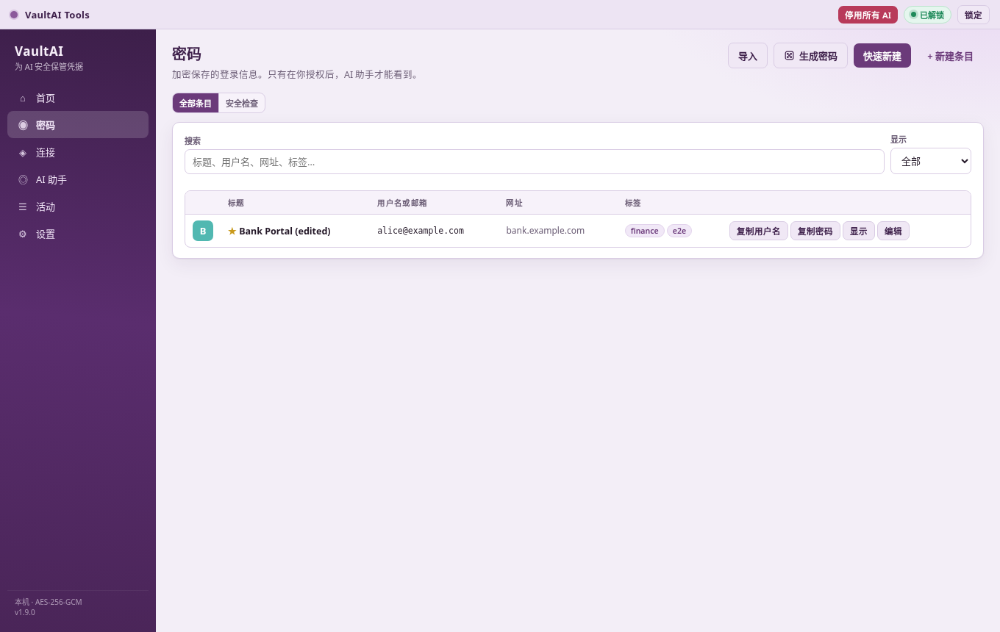
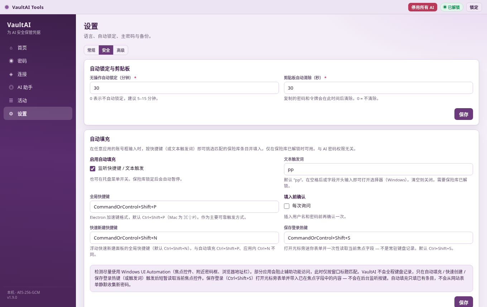
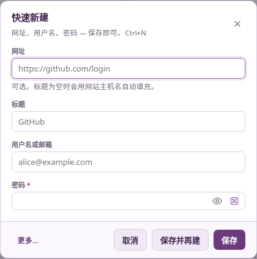
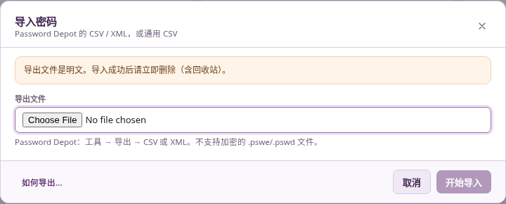

# VaultAI

**1.9.0** · 给 AI 用的密码管家：本地保险库保存凭据，按令牌把有限访问交给 Claude、Cursor 等助手，而不是把全部密码贴进对话。

## 界面截图



*密码列表 / Password list*



*自动填充设置 / Autofill settings*



*快速新建 / Quick create*



*导入 / Import*

## 功能特性

- 本地主密码保险库；主密码无法找回，请务必自行保管。
- 把连接配置提供给 Claude Desktop / Cursor（JSON）、Claude Code（`claude mcp add`）或命令行环境变量，并用令牌控制访问。
- 可把密码直接存到 SQLite / PostgreSQL / MySQL（默认 AES-256-GCM 加密字段）。
- 自动填充、TOTP、快速新建、导入 Password Depot 明文 CSV / XML。
- 首页显示各 AI 的访问范围、成功 / 拒绝请求，以及一键停用所有 AI。

## 技术栈

- TypeScript
- 本地服务（默认 http://127.0.0.1:3847）
- 可选 Electron 窗口

## 从源码运行

源码在仓库根目录。本仓库不包含安装包。

```bash
npm install
npm run build
npm start            # http://127.0.0.1:3847
# 桌面窗口请按该目录 package.json / BUILD.md 中的 electron 脚本
```
API 密钥与主密码只保存在本机。详见仓库根目录下的专题文档。

## 文档

- [docs/DB-STORAGE.md](docs/DB-STORAGE.md)
- [docs/IMPORT.md](docs/IMPORT.md)
- [构建](BUILD.md)
- [自动填充](AUTOFILL.md)
- [数据库存储](DB-STORAGE.md)
- [导入](IMPORT.md)
- [TOTP](TOTP.md)
- [安装说明](安装说明.txt)


## 贡献

欢迎通过 Issue 和 Pull Request 参与，详见 [CONTRIBUTING.md](CONTRIBUTING.md)。安全问题请按 [SECURITY.md](SECURITY.md) 私下报告。参与时请遵守 [CODE_OF_CONDUCT.md](CODE_OF_CONDUCT.md)。

## 许可证

`package.json` 声明为 MIT。仓库根目录未附带 LICENSE 文件。

---

## English

# VaultAI

**1.9.0** · A password manager built for AI: keep credentials in a local vault, and grant assistants such as Claude or Cursor limited access via tokens — instead of pasting every secret into chat.

## Screenshots


*密码列表 / Password list*


*自动填充设置 / Autofill settings*


*快速新建 / Quick create*


*导入 / Import*

## Features

- Local master-password vault. The master password cannot be recovered — keep it safe.
- Hand connection config to Claude Desktop / Cursor (JSON), Claude Code (`claude mcp add`), or CLI environment variables, with token-scoped access.
- Optional direct storage in SQLite / PostgreSQL / MySQL (fields encrypted with AES-256-GCM by default).
- Autofill, TOTP, quick create, and import of Password Depot plaintext CSV / XML.
- The home view shows each assistant's scope, allow/deny counts, and a button to disable all AI access.

## Tech stack

- TypeScript
- 本地服务（默认 http://127.0.0.1:3847）
- 可选 Electron 窗口

## Getting started

Source is at the repository root. This repository does not include installers.

```bash
npm install
npm run build
npm start            # http://127.0.0.1:3847
# For a desktop window, use the electron script in that package.json / BUILD.md
```
API keys and the master password stay on this machine. See the topic docs at the repository root.

## Documentation

- [docs/DB-STORAGE.md](docs/DB-STORAGE.md)
- [docs/IMPORT.md](docs/IMPORT.md)
- [构建](BUILD.md)
- [自动填充](AUTOFILL.md)
- [数据库存储](DB-STORAGE.md)
- [导入](IMPORT.md)
- [TOTP](TOTP.md)
- [安装说明](安装说明.txt)


## Contributing

Issues and pull requests are welcome. See [CONTRIBUTING.md](CONTRIBUTING.md). Please report vulnerabilities privately via [SECURITY.md](SECURITY.md). This project follows [CODE_OF_CONDUCT.md](CODE_OF_CONDUCT.md).

## License

`package.json` declares MIT. There is no LICENSE file at the repository root.
